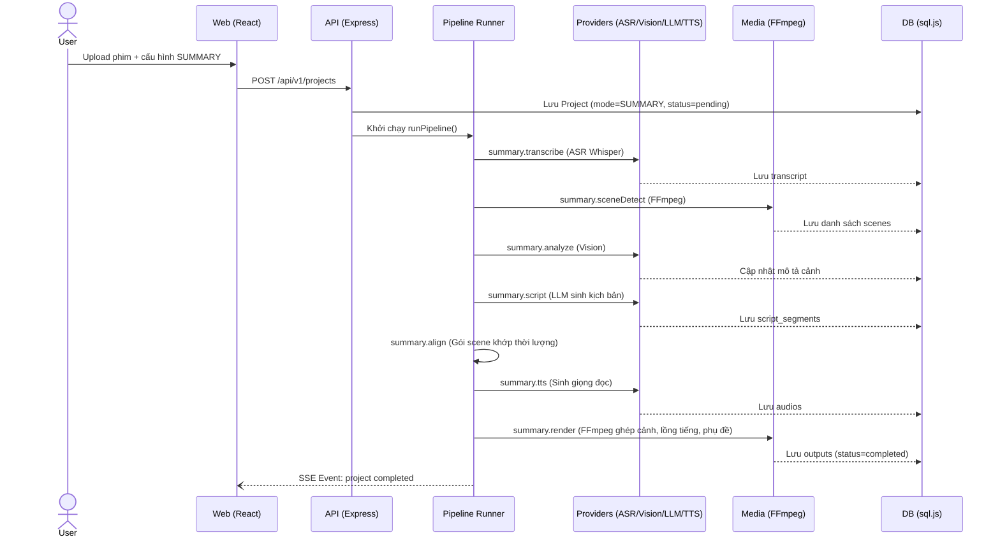
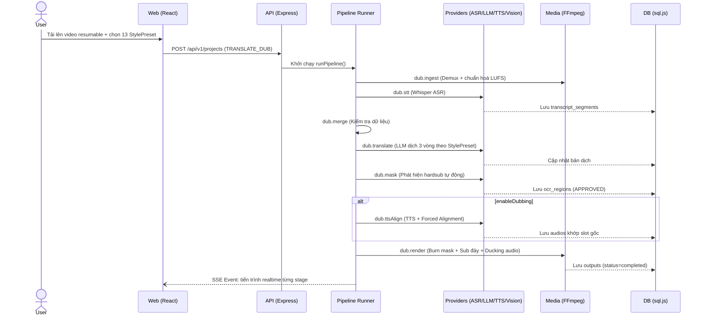
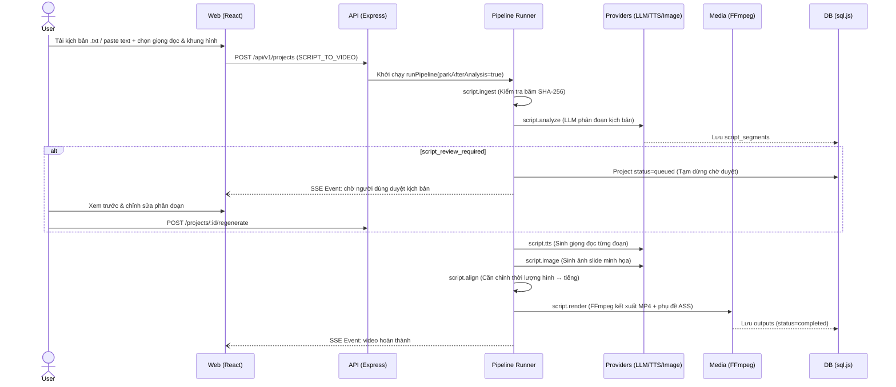

# 01 — Kiến trúc tổng thể

# Current Implementation (CURRENT)

- **Cấu trúc Repository**: Bố cục phẳng `backend/` và `frontend/` (JavaScript ESM, không `apps/` + `packages/`).
- **Cơ sở dữ liệu**: `sql.js` (WebAssembly SQLite) ghi tệp `backend/data.db` với **30 bảng** định nghĩa tại `backend/src/db/schema.js` (bao gồm bảng `timeline_tracks` và các trường mở rộng của `timeline_clips` và `assets`). Cơ chế lưu trữ: atomic in-memory snapshot sang đĩa, single-writer lock (`data.db.writer.lock`), hàng đợi tuần tự hóa các truy vấn ghi (`query.js`), giám sát trạng thái `HEALTHY` / `DEGRADED` / `WRITE_BLOCKED`.
- **Pipeline điều phối (`backend/src/pipeline/runner.js`)**: Hỗ trợ **4 chế độ** (3 mode tạo mới chính thức + 1 mode legacy):
  - `MEDIA_COMPOSER` (3 stages - Flagship mới): `composer.ingest → composer.prepare → composer.render`. Tự động kiểm tra & dàn xếp timeline khớp voiceover (`composerIngest`), chuẩn hóa kích thước/tỷ lệ khung hình ảnh và sinh phụ đề ASS UTF-8 (`composerPrepare`), kết hợp visual 2 lớp (Background + Slideshow motion 1.05x), lặp vô hạn BGM (`aloop`), dynamic sidechain ducking (-12dB khi có giọng nói) và xuất video MP4 Full HD (`composerRender`).
  - `TRANSLATE_DUB` (7 stages): `dub.ingest → dub.stt → dub.merge → dub.translate → dub.mask → dub.ttsAlign → dub.render`. STT-only (Whisper ASR + 15s overlap stitching), 13 StylePreset, Masking (tự động hoặc thủ công), Forced Alignment TTS (`TEMPO_MAX = 1.35`), Dynamic Sidechain Ducking (-12dB).
  - `SCRIPT_TO_VIDEO` (7 stages): `script.ingest → script.analyze → script.tts → script.image → script.align → script.subtitle → script.render`. Phân đoạn kịch bản qua LLM/quy tắc, review gate (`script_review_required = 1`), TTS phân đoạn, tạo slide ảnh minh họa, căn chỉnh timeline và render MP4.
  - `SUMMARY` (8 stages - Legacy): `summary.transcribe → summary.sceneDetect → summary.analyze → summary.script → summary.align → summary.tts → summary.subtitle → summary.render`.
- **Dịch vụ & Module AI Media Composer**:
  - Backend: `backend/src/services/composerService.js` (quản lý 5 rãnh timeline, tải lên tài nguyên, OCR 2-tier cache, dịch thuật 2-tier cache, AI voiceover TTS, dàn dựng autoArrangeTimeline, lưu trữ an toàn saveTimeline), `backend/src/routes/v1/composerAssets.js` (8 REST endpoints).
  - Frontend: `frontend/src/components/composer/` (`MediaLibrary.jsx`, `ComposerPreview.jsx`, `ClipInspector.jsx`, `OcrTranslateModal.jsx`, `TtsModal.jsx`), tích hợp Multi-track Timeline 5 rãnh với dual-handle trim trong `ProjectDetail.jsx`.
- **Hàng đợi & Worker (BullMQ + Redis 7)**: Điều phối `projectQueue`, `notifyQueue`, `cleanupQueue`, `drainQueue` với các workers `drainQueued`, `notifyWorker`, `cleanupWorker`, `youtubeUploadWorker`. Redis được thăm dò sẵn sàng tại `/health` và `npm run check:redis`, backend có cơ chế chạy degraded an toàn khi Redis chưa bật.
- **Sidecar ZeroTTS**: Tự động kích hoạt sidecar Python (`scripts/zerotts_service.py`) trong môi trường phát triển (`npm run dev`), backend chuyển đổi WAV sang MP3 bằng FFmpeg.
- **Mặt cắt API & SSE**: API REST tiền tố `/api/v1/`, Upload resumable kiểu TUS chunk 8MB (giới hạn 2GB), SSE realtime tiến trình `/projects/:id/events` dùng vé ngắn hạn một lần (`sse-ticket`), tĩnh bảo mật tại `/storage/<key>`.
- **Mask Editor & Subtitle**: `MaskEditor.jsx` Canvas trực tiếp tại `ProjectDetail` quản lý lifecycle `DRAFT`, `APPROVED`, `DISABLED`. Mask `APPROVED` là bất biến (immutable); render chỉ áp dụng mask `APPROVED`.
- **Chạy lại & Tiếp tục**: `POST /projects/:id/regenerate` hỗ trợ tiếp tục tự động từ stage chưa hoàn thành (`firstRunnableStage`) hoặc chạy lại từ một stage chỉ định (`fromStage`).

# Target Architecture (FUTURE — NOT IMPLEMENTED)

> Mọi nội dung phía dưới là thiết kế tương lai (giữ nguyên, không xóa); chỉ các đoạn gắn nhãn CURRENT/PARTIAL mới phản ánh code hiện tại trên branch main.
>
> **Lưu ý Triển khai:** Tài liệu này mô tả thiết kế target (monorepo với `apps/` + `packages/`).
> Triển khai hiện tại dùng cấu trúc phẳng `backend/` + `frontend/` với JavaScript (không TypeScript).

---

## 1. Cấu trúc Monorepo (pnpm workspaces) [TARGET/FUTURE]

```
AI-Shorts-Factory/
├── apps/
│   ├── web/                  # Dashboard (React 19 + Vite)
│   └── api/                  # REST API (Express + TS)
├── packages/
│   ├── core/                 # Domain: entities, interfaces, orchestrator pipeline
│   ├── ai/                   # AIProvider (LLM) + Gemini/OpenAI/Anthropic/HuggingFace
│   ├── providers/
│   │   ├── asr/              # AsrProvider: Whisper / Faster-Whisper / OpenAI Whisper
│   │   ├── tts/              # TtsProvider: ElevenLabs / Google / Azure / OpenAI / ZeroTTS
│   │   ├── vision/           # VisionProvider: Gemini / CLIP (hiểu cảnh phim)
│   │   └── video-gen/        # (mở rộng) Kling/Hailuo/PixVerse...
│   ├── media/                # FFmpeg wrapper: transcode, scene-detect, concat, conform, grade
│   ├── queue/                # BullMQ + Redis: định nghĩa job, worker
│   ├── database/             # Prisma client + migrations
│   ├── shared/               # Zod schemas, types, constants, i18n
│   └── storage/              # Abstraction storage: local disk / S3
├── storage/                  # Volume lưu asset (images/audio/videos/subtitles/outputs)
├── docker/                   # Dockerfile, docker-compose, nginx
├── scripts/                  # migrate, seed, bench
└── docs/
```

**Quy tắc phụ thuộc (Dependency Rule):**
`apps/api` → `packages/core` → `packages/{ai,providers,media,queue,database,storage}` → `packages/shared`.
Lớp trên không được import implementation cụ thể của lớp dưới; chỉ qua **interface + DI**.

---

## 2. Tầng kiến trúc (Clean Architecture) [TARGET/FUTURE]

```
┌──────────────────────────────────────────────────────────┐
│ Presentation: apps/web (React)  +  apps/api (Controllers) │
├──────────────────────────────────────────────────────────┤
│ Application / Use-cases: services trong packages/core     │
│   - CreateProjectUseCase, SummaryPipeline, TranslateDubPipeline, ScriptToVideoPipeline │
├──────────────────────────────────────────────────────────┤
│ Domain: entities, interfaces (AIProvider, AsrProvider...)  │
├──────────────────────────────────────────────────────────┤
│ Infrastructure: providers/*, media, database, storage, queue│
└──────────────────────────────────────────────────────────┘
```

- **Controllers** (api) chỉ parse request, gọi use-case, trả response.
- **Use-cases** (core) chứa business logic, điều phối provider qua interface.
- **Infrastructure** cài đặt interface; được bơm (inject) vào core qua DI container.

---

## 3. Các luồng pipeline

### 3.1. Mode `MEDIA_COMPOSER` (AI Media Composer — Flagship)

```
Kho tư liệu (Images, Background, BGM, Voiceover) + Kịch bản
   │
   ▼  [composer.ingest]      Kiểm tra timeline & tài nguyên; nếu trống gọi autoArrangeTimeline; tính duration
   ▼  [composer.prepare]     Scale & pad ảnh theo tỷ lệ khung hình; chuẩn hoá audio 48kHz; sinh phụ đề ASS UTF-8 (\fn, \c, \fs)
   ▼  [composer.render]      FFmpeg multi-layer (Background + Slideshow motion 1.05x), BGM loop (aloop), dynamic ducking (-12dB), burn-in ASS → MP4
   ▼  [upload?]              YouTube (tuỳ chọn)
```

### 3.2. Mode `SUMMARY` (Review phim & Video tóm tắt — Legacy)

```
Phim (2–3h)
   │
   ▼  [summary.transcribe]   ASR Whisper → transcript (timestamp)
   ▼  [summary.sceneDetect]  FFmpeg → Scene[] (start/end/thumbnail)
   ▼  [summary.analyze]      VisionProvider → mô tả mỗi Scene
   ▼  [summary.script]       LLM → ScriptSegment[] (lời review + scene ref)
   ▼  [summary.align] ★      TTS đoạn → duration; gói Scene thành TimelineClip[]
   ▼  [summary.tts]          TtsProvider → Audio (giọng review)
   ▼  [summary.subtitle]     Sinh phụ đề ASS/SRT khớp TTS
   ▼  [summary.render]       FFmpeg → Video 20–30 phút hoàn chỉnh
   ▼  [upload?]              YouTube (tuỳ chọn)
```

### 3.3. Mode `TRANSLATE_DUB` (Dịch thuật & Lồng tiếng)

```
Video nước ngoài (≤ 2GB)
   │
   ▼  [dub.ingest]           Resumable upload (chunk 8MB) → demux audio/video → normalize LUFS
   ▼  [dub.stt]              ASR Whisper + overlap stitching 15s → transcript (timestamp)
   ▼  [dub.merge]            Barrier kiểm tra: transcript, translation, duration, language
   ▼  [dub.translate]        LLM + StylePreset (13 phong cách) gom context window (TransFlow 3 vòng)
   ▼  [dub.mask]             Vision detect hardsub boxes hoặc nạp mask người dùng
   ▼  [dub.ttsAlign?]        TTS + Forced Alignment ép khớp slot gốc (TEMPO_MAX=1.35, pause-expansion)
   ▼  [dub.render]           Burn mask APPROVED + Burn sub mới (neo đáy \an2) + Ducking (-12dB) + NVENC
   ▼  [upload?]              YouTube (tuỳ chọn)
```

### 3.4. Mode `SCRIPT_TO_VIDEO` (Tạo video từ kịch bản)

```
Kịch bản văn bản (.txt)
   │
   ▼  [script.ingest]        Kiểm tra toàn vẹn băm SHA-256, lưu script/source.txt
   ▼  [script.analyze]       LLM phân tách thành script_segments (narration + visual prompt)
   ▼  [Review Gate]          (Tạm dừng nếu script_review_required=1 để user kiểm tra/sửa)
   ▼  [script.tts]           TTS Provider sinh audio giọng đọc cho từng phân đoạn
   ▼  [script.image]         SlideImage sinh hình ảnh minh họa cho từng phân đoạn
   ▼  [script.align]         Căn chỉnh thời lượng hình ảnh khớp chính xác với audio
   ▼  [script.subtitle]      Tạo phụ đề ASS/SRT đồng bộ giọng đọc
   ▼  [script.render]        FFmpeg kết xuất video MP4 kết hợp ảnh, voice, nhạc nền và phụ đề
   ▼  [upload?]              YouTube (tuỳ chọn)
```

**So sánh cốt lõi:**
- `MEDIA_COMPOSER`: **Dựng đa phương tiện tự do**, hỗ trợ tải lên đa tài nguyên (ảnh, nền, BGM, voiceover), dàn xếp thông minh qua timeline 5 rãnh độc lập, kết hợp đa lớp visual và dynamic audio ducking.
- `TRANSLATE_DUB`: **Giữ nguyên nhịp hình ảnh gốc**, chỉ thay lớp ngôn ngữ (phụ đề dịch + giọng lồng tiếng ép khớp slot thời gian gốc).
- `SCRIPT_TO_VIDEO`: Bắt đầu từ **văn bản thuần túy**, sinh ra toàn bộ âm thanh và hình ảnh slide tương ứng, tự động dựng thành video.
- `SUMMARY`: Cắt từ **1 video nguồn duy nhất** (phim dài), thuật toán `align` gói các Scene lại để khớp thời lượng lời review; kết quả là video dựng mới (Legacy).

---

## 4. Provider Pattern [TARGET/FUTURE]

> [TARGET/FUTURE] — Interface TypeScript trong `packages/` là thiết kế tương lai. CURRENT: provider JS trong `backend/src/providers/` (xem `11_RATE_LIMIT_VA_FREE_TIER.md` cho RateLimiter + ProviderCache hiện tại).

Mọi dịch vụ ngoài được trừu tượng hoá qua interface. Ví dụ `TtsProvider`:

```ts
// packages/providers/tts/types.ts
export interface TtsProvider {
  readonly id: string;                 // 'elevenlabs' | 'google' | 'azure' | 'openai' | 'zerotts' | 'edge_tts'
  synthesize(input: TtsInput): Promise<TtsResult>;
}

export interface TtsInput {
  text: string;
  language: string;                   // 'vi', 'en'...
  voiceId?: string;
  speed?: number;                     // 0.9–1.1
}

export interface TtsResult {
  audioKey: string;                   // storage key
  durationSec: number;                // ★ thời lượng CHÍNH XÁC (dùng cho align)
  provider: string;
  model: string;
  meta?: Record<string, unknown>;
}
```

Tương tự: `AIProvider` (LLM), `AsrProvider` (transcribe + word timestamps), `VisionProvider` (mô tả cảnh / phát hiện hardsub), `ImageProvider` (sinh ảnh slide).

**Registry + Strategy:** Dùng DI container ánh xạ `providerId → implementation`. Use-case chỉ gọi `container.resolve('tts', settings.voiceProvider)`. Thêm provider = thêm 1 file implement + đăng ký, **không sửa** business logic.

---

## 5. Hàng đợi (BullMQ + Redis)

> [CURRENT]: Pipeline chạy sequential trong `backend/src/pipeline/runner.js`; BullMQ + Redis được sử dụng cho 4 queues: `projectQueue`, `notifyQueue`, `cleanupQueue`, `drainQueue` (`backend/src/queue/`).

Các công đoạn trong các chế độ pipeline:

| Job / Stage | Mode | Thực thi bởi | Retry Policy |
| --- | --- | --- | --- |
| `summary.transcribe` | SUMMARY | AsrProvider (Whisper) | 3, exp backoff |
| `summary.sceneDetect` | SUMMARY | Media (FFmpeg) | 2 |
| `summary.analyze` | SUMMARY | VisionProvider (Gemini) | 3 |
| `summary.script` | SUMMARY | LLMProvider (Gemini/OpenAI) | 3 |
| `summary.align` | SUMMARY | AlignService (core) | 2 |
| `summary.tts` | SUMMARY | TtsProvider (Edge/Google/ElevenLabs) | 3 |
| `summary.subtitle` | SUMMARY | Media (Core/FFmpeg) | 2 |
| `summary.render` | SUMMARY | Media (FFmpeg) | 2 |
| `dub.ingest` | TRANSLATE_DUB | Media (demux + LUFS) | 2 |
| `dub.stt` | TRANSLATE_DUB | AsrProvider (Whisper) | 3 |
| `dub.merge` | TRANSLATE_DUB | Core (barrier, check DB) | 1 |
| `dub.translate` | TRANSLATE_DUB | LLM + 13 StylePresets | 3 |
| `dub.mask` | TRANSLATE_DUB | Vision / User Masks | 2 |
| `dub.ttsAlign` | TRANSLATE_DUB | TTS + ForcedAlignService | 3 |
| `dub.render` | TRANSLATE_DUB | Media (FFmpeg burn/mix/mux) | 2 |
| `script.ingest` | SCRIPT_TO_VIDEO| Core (SHA-256 integrity) | 2 |
| `script.analyze` | SCRIPT_TO_VIDEO| LLMProvider (phân đoạn) | 3 |
| `script.tts` | SCRIPT_TO_VIDEO| TtsProvider | 3 |
| `script.image` | SCRIPT_TO_VIDEO| SlideImage / ImageProvider | 2 |
| `script.align` | SCRIPT_TO_VIDEO| Core (căn chỉnh thời lượng) | 2 |
| `script.subtitle` | SCRIPT_TO_VIDEO| Core / Media | 2 |
| `script.render` | SCRIPT_TO_VIDEO| Media (FFmpeg video render) | 2 |
| `output.uploadYoutube`| OUTPUT | YouTube OAuth Worker | 2 |

Mỗi job **idempotent**: key theo `(projectId, stage)`. Thất bại do lỗi tạm thời → tự động retry; hết retry hoặc gặp lỗi dữ liệu → đánh dấu `failed` và ghi log chi tiết.

---

## 6. Sơ đồ trình tự (Sequence Diagrams)

### 6.1. Sơ đồ trình tự — SUMMARY



### 6.2. Sơ đồ trình tự — TRANSLATE_DUB



### 6.3. Sơ đồ trình tự — SCRIPT_TO_VIDEO



---

## 7. Lưu trữ tệp (Storage Abstraction)

- Mọi tệp tải lên (video nguồn, kịch bản) và tệp sinh ra (audio, ảnh slide, phụ đề ASS, video đầu ra) được lưu trữ tại `storage/` trên máy chủ cục bộ hoặc volume Docker (`/app/storage`).
- Đường dẫn truy xuất an toàn thông qua middleware `createSafeMediaStatic` tại `/storage/<key>`, có cơ chế chống Directory Traversal (`isPathInside`) và cấm duyệt symlink độc hại.

---

## 8. Xử lý lỗi & Phục hồi (Fault-Tolerance & Recovery)

1. **Stale Project Recovery**: Khi máy chủ khởi động lại, `recoverStaleProjects()` quét toàn bộ dự án kẹt ở trạng thái `running` và chuyển về `queued` để chạy tiếp từ `firstRunnableStage`.
2. **Durable Cleanup Tasks**: Các tác vụ dọn dẹp ổ đĩa sau khi xóa dự án được lưu vào bảng `project_cleanup_tasks` (outbox pattern), đảm bảo file luôn được dọn ngay cả khi Redis gián đoạn.
3. **Optimistic Concurrency**: Mọi sửa đổi transcript hoặc mask APPROVED đều tăng `projects.transcript_version`. Các video output gắn kèm `transcript_version` thời điểm render; nếu version lệch, API và giao diện đánh dấu `outputStale: true` để cảnh báo cần render lại.
4. **Graceful Cancellation**: `POST /projects/:id/cancel` kích hoạt `AbortController`, dừng các stage đang chờ hoặc đang chạy, dọn dẹp thư mục tạm và cập nhật trạng thái `cancelled`.
