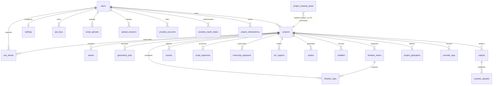

# Tài Liệu Thiết Kế & Hướng Dẫn Cơ Sở Dữ Liệu PostgreSQL (PostgreSQL Architecture Guide)

**Dự án:** Video_AI  
**Tác giả:** Database Architect (`@db_architect`)  
**Ngày ban hành:** 13/11/2026  
**Phiên bản:** 1.0.0  
**Tệp DDL Nguồn:** `backend/src/db/postgresSchema.sql`  

---

## 1. Tổng Quan Kiến Trúc & Mục Tiêu Thiết Kế

Hệ thống **Video_AI** chuyển dịch từ SQLite (`sql.js` in-memory + atomic file snapshot) sang **PostgreSQL 16+** nhằm đáp ứng các yêu cầu kiến trúc trọng yếu:
1. **Concurrency Cao & Đa Tiến Trình (Multi-Process Scalability):** Loại bỏ giới hạn single-writer lock của SQLite; hỗ trợ đồng thời hàng trăm API requests và BullMQ background workers mà không bao giờ bị nghẽn `WriteQueueFullError` hay `DB_PERSISTENCE_BLOCKED`.
2. **Toàn Vẹn Dữ Liệu Cứng (ACID & Foreign Key Integrity):** Khai báo tường minh khóa ngoại (FKs) với chính sách `ON DELETE CASCADE` / `ON DELETE SET NULL`, ngăn chặn hoàn toàn hiện tượng bản ghi mồ côi (orphans).
3. **Hiệu Năng JSON Native (`JSONB`):** Thay thế chuỗi JSON dạng TEXT bằng kiểu dữ liệu nhị phân `JSONB`, cho phép đánh chỉ mục `GIN` để truy vấn thuộc tính lồng nhau siêu tốc.
4. **Chuẩn Hóa Thời Gian & Boolean:** Sử dụng kiểu chuẩn `TIMESTAMPTZ` (chính xác đến microsecond, hỗ trợ timezone) và `BOOLEAN` native thay cho `INTEGER 0/1`.
5. **Đảm Bảo 100% Khả Năng Tương Thích:** Hỗ trợ đầy đủ cả 4 chế độ hoạt động của Video_AI:
   - `MEDIA_COMPOSER` (Flagship: Timeline đa tầng, audio ducking, keyframes, transitions).
   - `TRANSLATE_DUB` (Dịch thuật, lồng tiếng, subtitle-masking, OCR region lifecycle).
   - `SCRIPT_TO_VIDEO` (Kịch bản sang video, phân đoạn, hình ảnh AI sinh ra).
   - `SUMMARY` (Tóm tắt video dài thành video ngắn theo cảnh quay).

---

## 2. Sơ Đồ Thực Thể & Quan Hệ (Entity-Relationship Diagram)



---

## 3. Ma Trận Chuyển Đổi Kiểu Dữ Liệu (SQLite → PostgreSQL)

| Kiểu Dữ Liệu Trong SQLite | Kiểu Chuẩn Trong PostgreSQL | Ví Dụ Cột Ứng Dụng | Lý Do Kỹ Thuật |
|:---|:---|:---|:---|
| `TEXT` (UUID/NanoID) | `VARCHAR(64)` | `id`, `project_id`, `user_id` | Tối ưu dung lượng lưu trữ, lập chỉ mục B-Tree nhanh hơn TEXT không giới hạn |
| `INTEGER PRIMARY KEY AUTOINCREMENT` | `BIGSERIAL` | `reset_tokens.id`, `otp_codes.id` | Tự động quản lý sequence 64-bit, chống tràn số |
| `TEXT` (JSON string) | `JSONB` | `params`, `meta`, `result`, `cues` | Parsing nhị phân 1 lần, hỗ trợ chỉ mục GIN, truy vấn jsonpath |
| `TEXT` (ISO/Datetime string) | `TIMESTAMPTZ` | `created_date`, `expires_at` | Lưu trữ UTC chuẩn xác, tự động nhận dạng cả format SQLite lẫn ISO 8601 |
| `INTEGER` (0 / 1) | `BOOLEAN` | `email_verified`, `is_active`, `used` | Đúng ngữ nghĩa chuẩn quan hệ, tiết kiệm dung lượng (1 byte) |
| `REAL` (Float) | `DOUBLE PRECISION` | `duration_sec`, `start_sec`, `volume` | Độ chính xác 64-bit dấu phẩy động cho timeline và video sync |
| `INTEGER` (kích thước file/bytes) | `BIGINT` | `byte_size`, `bytes_sent`, `size` | Ngăn ngừa tràn số 32-bit khi tải video dung lượng lớn (>2GB) |

---

## 4. Danh Mục 31 Bảng & Ràng Buộc Khóa Ngoại (Foreign Key Strategy)

Toàn bộ 31 bảng được tổ chức thành 7 phân hệ nghiệp vụ:

### 4.1. Phân Hệ Người Dùng & Bảo Mật (Users & Security)
1. **`users`**: Thực thể gốc quản lý danh tính người dùng (`id VARCHAR(64) PRIMARY KEY`, `email UNIQUE`, `password`, `role`).
2. **`reset_tokens`**: Mã khôi phục mật khẩu (`id BIGSERIAL PRIMARY KEY`, `email`, `token`, `expires_at`, `used BOOLEAN`).
3. **`email_otps`**: Mã OTP xác thực email (`id VARCHAR(64) PRIMARY KEY`, `email`, `otp_hash`, `expires_at`, `attempts`, `used BOOLEAN`).
4. **`otp_codes`**: Bảng OTP legacy (`id BIGSERIAL PRIMARY KEY`, duy trì tương thích dữ liệu cũ).
5. **`api_keys`**: Khóa API AI của người dùng (`user_id REFERENCES users(id) ON DELETE CASCADE`).
6. **`settings`**: Cấu hình mặc định cho từng tài khoản (`user_id PRIMARY KEY REFERENCES users(id) ON DELETE CASCADE`).

### 4.2. Phân Hệ Dự Án & Tiến Trình Cốt Lõi (Projects & Core Workflow)
7. **`projects`**: Thông tin trung tâm của mọi luồng xử lý video (`user_id REFERENCES users(id) ON DELETE CASCADE`, `params JSONB`).
8. **`assets`**: File tài nguyên tải lên và thư viện media (`project_id REFERENCES projects(id) ON DELETE CASCADE`, `meta JSONB`).
9. **`generation_jobs`**: Tiến trình thực thi từng công đoạn pipeline (`project_id REFERENCES projects(id) ON DELETE CASCADE`, `payload JSONB`, `result JSONB`, ràng buộc UNIQUE `(project_id, type)`).

### 4.3. Phân Hệ Timeline & Dựng Phim Đa Lớp (Timeline & Media Composer)
10. **`timeline_tracks`**: Rãnh timeline đa tầng (`project_id REFERENCES projects(id) ON DELETE CASCADE`, `track_type`, `order_index`, `muted BOOLEAN`, `locked BOOLEAN`).
11. **`timeline_clips`**: Phân đoạn clip trên timeline kết xuất:
    - `project_id REFERENCES projects(id) ON DELETE CASCADE`
    - `track_id REFERENCES timeline_tracks(id) ON DELETE SET NULL` *(Nếu xóa một track, các clip thuộc track đó không bị xóa mất dữ liệu mà được giải phóng về unassigned track)*.
    - `style_json JSONB`, `meta JSONB`.

### 4.4. Phân Hệ Tóm Tắt & Kịch Bản AI (Summary & Script-to-Video)
12. **`scenes`**: Cảnh quay phát hiện tự động (`project_id REFERENCES projects(id) ON DELETE CASCADE`, `embedding JSONB`).
13. **`script_segments`**: Đoạn kịch bản review lời bình (`project_id REFERENCES projects(id) ON DELETE CASCADE`, `scene_refs JSONB`).
14. **`script_uploads`**: Tệp kịch bản tải lên cho Script-to-video (`user_id REFERENCES users(id) ON DELETE CASCADE`).

### 4.5. Phân Hệ Dịch Thuật & Lồng Tiếng (Translate & Dubbing)
15. **`transcript_segments`**: Từng câu thoại trích xuất từ audio (`project_id REFERENCES projects(id) ON DELETE CASCADE`, các cờ `is_time_manually_adjusted BOOLEAN`, `is_text_manually_edited BOOLEAN`, `is_translation_manually_edited BOOLEAN`).
16. **`ocr_regions`**: Vùng che mờ hardsub video (`project_id REFERENCES projects(id) ON DELETE CASCADE`, `is_static BOOLEAN`, `enabled BOOLEAN`).
17. **`style_presets`**: 13 phong cách dịch dựng sẵn (`slug UNIQUE`, `is_system BOOLEAN`).
18. **`project_glossaries`**: Từ điển thuật ngữ dự án (`project_id REFERENCES projects(id) ON DELETE CASCADE`, `case_sensitive BOOLEAN`).

### 4.6. Phân Hệ Sản Phẩm Đầu Ra & Xuất Bản (Artifacts & Publishing)
19. **`audios`**: File âm thanh sinh ra (`project_id REFERENCES projects(id) ON DELETE CASCADE`).
20. **`subtitles`**: File phụ đề (.srt / cues JSON) (`project_id REFERENCES projects(id) ON DELETE CASCADE`, `cues JSONB`).
21. **`outputs`**: Video thành phẩm cuối cùng (`project_id REFERENCES projects(id) ON DELETE CASCADE`).
22. **`youtube_uploads`**: Trạng thái đẩy video lên YouTube (`output_id REFERENCES outputs(id) ON DELETE CASCADE`).
23. **`youtube_accounts`**: Tài khoản kênh YouTube liên kết (`user_id REFERENCES users(id) ON DELETE CASCADE`).
24. **`youtube_oauth_states`**: Quản lý phiên PKCE OAuth (`user_id REFERENCES users(id) ON DELETE CASCADE`).

### 4.7. Phân Hệ Vận Hành, Rate Limit & Hàng Đợi (Operations & Infrastructure)
25. **`provider_logs`**: Nhật ký chi tiết mọi lệnh gọi AI (`project_id REFERENCES projects(id) ON DELETE SET NULL`).
    > *Lưu ý:* Chọn `ON DELETE SET NULL` để khi một project bị xóa, lịch sử tiêu tốn token và chi phí API vẫn được lưu giữ trọn vẹn để kiểm toán tài chính.
26. **`provider_rate_limits`**: Cấu hình RPM, RPD của các nhà cung cấp AI.
27. **`provider_cache`**: Bộ đệm cache kết quả AI (`input_hash`, `result JSONB`, UNIQUE `(provider, type, input_hash)`).
28. **`sse_tickets`**: Vé xác thực ngắn hạn EventSource (`user_id` và `project_id REFERENCES ... ON DELETE CASCADE`).
29. **`project_idempotency`**: Khóa chống trùng lặp tạo dự án (Composite PK `(user_id, idem_key)`).
30. **`project_cleanup_tasks`**: Outbox dọn tệp lưu trữ filesystem sau khi xóa project (`keys_json JSONB`).
    > **QUY TẮC BẮT BUỘC:** Cột `project_id` trong bảng này **KHÔNG CÓ KHÓA NGOẠI** tới `projects(id)`. Bảng này lưu trữ tác vụ xóa file xảy ra *sau khi* project đã bị xóa khỏi database. Nếu đặt FK, hệ thống sẽ không thể xóa project hoặc task sẽ bị xóa mất trước khi worker kịp dọn dẹp file!
31. **`upload_sessions`**: Phiên upload resumable TUS-style (`user_id REFERENCES users(id) ON DELETE CASCADE`).

---

## 5. Hướng Dẫn Di Chuyển Dữ Liệu (Phase 4 Migration Guide cho `@backend_lead`)

Để đảm bảo quá trình di chuyển từ SQLite sang PostgreSQL thành công 100%, không vi phạm ràng buộc toàn vẹn khóa ngoại, Backend Engineer cần thực hiện theo các bước chuẩn mực sau:

### Bước 1: Tiền Xử Lý Dữ Liệu (Pre-Migration Data Sanitization)
1. **User Đại Diện:** SQLite hiện có 1 project và 1 settings tham chiếu `user_id = 'user-live-test'` mà không có user này trong `users`. Script migration cần tự động chèn một bản ghi user đại diện nếu chưa tồn tại:
   ```sql
   INSERT INTO users (id, email, password, role, name)
   VALUES ('user-live-test', 'live-test@video-ai.internal', '$2a$10$dummyHashForTestingPurposesOnly...', 'user', 'Live Test User')
   ON CONFLICT (id) DO NOTHING;
   ```
2. **Dọn Rãnh Timeline Mồ Côi:** Bỏ qua 66 bản ghi trong `timeline_tracks` và 4 vé trong `sse_tickets` có `project_id` không tồn tại trong `projects`.
3. **Chuẩn Hóa `provider_logs`:** Nếu `project_id` trong log không tồn tại trong `projects`, chuyển giá trị thành `NULL`.

### Bước 2: Thứ Tự Nạp Bảng Tuân Thủ Phụ Thuộc (Topological Insertion Order)
Nạp dữ liệu theo đúng thứ tự 8 nhóm sau:

```
[Nhóm 1: Bảng Gốc Độc Lập]
1. users
2. style_presets
3. provider_rate_limits
4. reset_tokens
5. otp_codes
6. email_otps
7. api_keys
8. youtube_accounts
9. youtube_oauth_states

[Nhóm 2: Cài Đặt Người Dùng]
10. settings

[Nhóm 3: Dự Án Cốt Lõi]
11. projects

[Nhóm 4: Tác Vụ Phụ Thuộc User/Project Độc Lập]
12. upload_sessions
13. script_uploads
14. project_idempotency
15. project_cleanup_tasks

[Nhóm 5: Các Thực Thể Con Trực Tiếp Của Dự Án]
16. assets
17. scenes
18. audios
19. subtitles
20. outputs
21. generation_jobs
22. project_glossaries
23. ocr_regions
24. transcript_segments
25. timeline_tracks

[Nhóm 6: Các Thực Thể Con Cấp 2]
26. timeline_clips (phụ thuộc projects & timeline_tracks)
27. script_segments
28. sse_tickets
29. youtube_uploads (phụ thuộc outputs)

[Nhóm 7: Hạ Tầng & Nhật Ký]
30. provider_logs
31. provider_cache
```

### Bước 3: Chuyển Đổi Dữ Liệu Từng Kiểu (Data Transformation Rules)
1. **Boolean:** Chuyển đổi số nguyên sang boolean:
   - `val === 1 || val === '1' || val === true ? true : false`
2. **JSONB:** Parse chuỗi JSON hợp lệ trước khi chèn vào `JSONB`:
   - `typeof val === 'string' ? JSON.parse(val) : val` (nếu null thì truyền `null` hoặc `'{}'`).
3. **Timestamp:** Chuyển chuỗi thời gian SQLite `YYYY-MM-DD HH:MM:SS` hoặc ISO string sang đối tượng `Date` / ISO string hợp lệ.

### Bước 4: Đồng Bộ Lại Sequence Cho Các Bảng Serial (Sequence Reset)
Sau khi nạp xong dữ liệu các bảng có khóa tự tăng (`reset_tokens`, `otp_codes`), bắt buộc chạy lệnh:
```sql
SELECT setval(pg_get_serial_sequence('reset_tokens', 'id'), COALESCE(MAX(id), 1)) FROM reset_tokens;
SELECT setval(pg_get_serial_sequence('otp_codes', 'id'), COALESCE(MAX(id), 1)) FROM otp_codes;
```

---

## 6. Hướng Dẫn Tích Hợp DBeaver & Vận Hành (cho `@devops`)

### 6.1. Thông Số Kết Nối Chuẩn
- **Host:** `localhost`
- **Port:** `5432` (hoặc cổng cấu hình trong `docker-compose.yml`)
- **Database Name:** `video_ai`
- **Username:** `video_ai_user`
- **Password:** Mật khẩu mạnh đặt trong biến môi trường `DB_PASSWORD`
- **Driver:** PostgreSQL (DBeaver tự động tải driver chuẩn mới nhất)

### 6.2. Kiểm Tra Nhanh Tính Toàn Vẹn Bằng SQL
Chạy truy vấn sau trong DBeaver để đối chiếu nhanh số lượng bản ghi:
```sql
SELECT 
    schemaname, 
    relname AS table_name, 
    n_live_tup AS row_count
FROM pg_stat_user_tables 
ORDER BY relname;
```

---
*Tài liệu được thiết kế và phê duyệt bởi Database Architect (`@db_architect`).*
